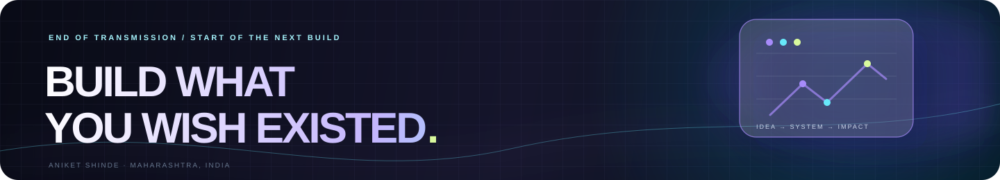

 

  

FULL-STACK ENGINEERING &nbsp; / &nbsp; APPLIED AI &nbsp; / &nbsp; DIGITAL COMMERCE &nbsp; / &nbsp; CREATIVE TECHNOLOGY

 

---

## THE PERSON BEHIND THE BUILDS

I’m **Aniket Shinde**, an independent developer and product builder from Maharashtra, India.

I build across the whole product surface — from the interface a customer touches to the APIs, databases, AI workflows, integrations, and infrastructure behind it. My work spans client-facing commerce systems, full-stack applications, desktop AI agents, and creative engineering tools.

I care about the part beyond the demo: the workflow, the edge cases, the visual finish, the reliability, and whether the thing is genuinely useful.

**My lane:** take a messy problem, understand the system behind it, and turn it into something people can actually use.

---

# 01 / CLIENT WORK & FREELANCE ENGINEERING

*Real business problems first. Product experiments second.*

I work with businesses on storefronts, digital experiences, commerce infrastructure, and AI-assisted production workflows. Some client codebases are private; the work below describes the engineering scope without exposing private implementation details.

<table>
<tr>
<td width="50%" valign="top">

CLIENT ECOSYSTEM  /  COMMERCE ENGINEERING

<h3>TIPASH LUXURIES</h3>

A connected luxury-commerce ecosystem spanning the web storefront and a native mobile shopping experience. The engineering scope includes catalogue and customer flows, loyalty, admin/POS operations, virtual stylist consultation, and commerce integrations.

<strong>Web + mobile:</strong> Next.js · React · TypeScript · Flutter · Dart

<strong>Platform:</strong> Supabase · Cloudflare R2 · Razorpay · MSG91 · Shiprocket · WebRTC

<a href="https://tipashluxuries.com">VISIT THE BRAND ↗</a>

Private client implementation · Tipash Luxuries / Tipash Makeup

</td>
<td width="50%" valign="top">

CLIENT BUILD  /  SHOPIFY + AI CREATIVE OPS

<h3>YAMUNA FASHION</h3>

An ethnic-fashion e-commerce engagement combining Shopify storefront work with a reusable AI-assisted product-visual workflow. The asset system is designed around consistent model references, pose and background libraries, lighting presets, and SKU-aware creative planning.

<strong>Commerce:</strong> Shopify · Liquid · Storefront UI

<strong>Creative workflow:</strong> Model references · Pose library · Background systems · Lighting presets · SKU mapping

Private client work · Storefront + product-content pipeline

</td>
</tr>
<tr>
<td width="50%" valign="top">

CLIENT TOOLING  /  VISUAL PRODUCTION

<h3>SHEGAONKAR JEWELLERS</h3>

An AI-assisted jewellery-visual workflow focused on reference-guided image creation, repeatable creative direction, and stronger visual consistency across product imagery.

<strong>Focus:</strong> Image-generation workflows · Reference analysis · Prompt systems · Product presentation

Private creative workflow · Iterative development

</td>
<td width="50%" valign="top">

INDEPENDENT DELIVERY  /  CUSTOM BUILDS

<h3>WEB & DIGITAL BUSINESS BUILDS</h3>

Freelance engineering across custom websites, high-fidelity landing pages, Shopify theme development, e-commerce interfaces, dashboards, and workflow automation.

<strong>Typical delivery:</strong> Discovery · UX direction · Frontend · Backend/API · Integrations · Deployment

<strong>Approach:</strong> Practical scope, polished UI, maintainable implementation.

Available for selected freelance projects and collaborations

</td>
</tr>
</table>

---

# 02 / FLAGSHIP SYSTEMS & PRODUCT ENGINEERING

## CREATIVE STUDIO
01 — PUBLIC REPOSITORY · V1.0.0 · MULTI-MODAL CREATIVE ENGINEERING

### [Creative Studio — Autonomous Multi-Modal Creative Engineering Workstation ↗](https://github.com/AniketShinde02/creative-studio)

**Not another carousel template generator.** Creative Studio is built to inspect visual references, reconstruct their design logic, develop editorial content, and render publication-ready carousel assets through a multi-stage AI and graphics pipeline.

It is designed to avoid the predictable template look: generic gradients, repeated card layouts, arbitrary typography, and visuals disconnected from the source reference.

<table>
<tr>
<td width="50%" valign="top">

**01 / REFERENCE INTELLIGENCE**

- Ingests screenshots, image sequences, and PDFs
- SHA-256 identity and perceptual-hash deduplication
- OpenCV and OCR-based layout/content extraction
- Visual analysis to reconstruct design intent

**02 / VISUAL DNA BLUEPRINT**

- Palette and contrast extraction
- Typography pairing and scale ratios
- Grid, spacing, geometry, and layout roles
- Reference-derived visual tokens instead of hardcoded themes

</td>
<td width="50%" valign="top">

**03 / EIGHT-STAGE EDITORIAL PIPELINE**

- Strategist and narrative architect
- Editorial copywriter and human-voice editor
- Schema and content quality gate
- Art direction, project assembly, and visual QA

**04 / VECTOR RENDERING & EXPORT**

- Satori-based JSX-to-SVG rendering
- Native Rust / Resvg rasterization
- High-resolution PNG, PDF, and social export workflows
- Contrast, spacing, and alignment checks

</td>
</tr>
</table>

**Inference and research layer:** provider registry across Groq, NVIDIA NIM, Mistral, Gemini/OpenAI vision, and local Ollama workflows, with web research and image-generation integrations.

<table>
<tr>
<td align="center" width="25%"><h2>186/186</h2>TESTS PASSED</td>
<td align="center" width="25%"><h2>&lt;45ms</h2>DOCUMENTED SLIDE RENDER</td>
<td align="center" width="25%"><h2>~4.8s</h2>8-SLIDE SYNTHESIS</td>
<td align="center" width="25%"><h2>14.77:1</h2>AVERAGE CONTRAST</td>
</tr>
</table>

Engineering figures are taken from the project's documented test and benchmark results; rendering benchmark is reported at 1080 × 1350 per slide.

**[EXPLORE CREATIVE STUDIO SOURCE CODE ↗](https://github.com/AniketShinde02/creative-studio)**

---

## NEXUS AI
02 — VOICE-FIRST AGENT · DESKTOP AUTOMATION · ORCHESTRATED EXECUTION

### [NEXUS — Neural Interface for Execution & System Understanding ↗](https://github.com/AniketShinde02/NEXUS-AI)

A context-aware desktop AI assistant designed to bridge natural voice interaction with real actions across the user's machine.

The system combines a voice pipeline, live model interaction, browser and desktop tools, persistent memory, and multi-step execution. Its current engineering track focuses on stabilizing the real-time session path and making the orchestration layer more reliable.

- **Voice interface:** Gemini Live, speech processing, VAD, and TTS integrations
- **Computer interaction:** browser automation, desktop actions, screenshots, and application control
- **Agent architecture:** task planning, DAG execution, tool orchestration, and workspace awareness
- **Memory:** persistent conversation/context storage with SQLite and vector retrieval workflows

**Core stack:** Python · FastAPI · React/Next.js · Gemini · Groq · WebRTC · Silero VAD · SQLite · LanceDB

**[EXPLORE NEXUS SOURCE CODE ↗](https://github.com/AniketShinde02/NEXUS-AI)**

---

## MORE PRODUCTS & BUILDS

<table>
<tr>
<td width="50%" valign="top">

### [BUILDOS ↗](https://github.com/AniketShinde02/BuildOs)

An AI-powered content intelligence and creative operating system. Its architecture explores multi-agent research and writing, live execution telemetry, human approval gates, Satori carousel rendering, model fallback routing, and social publishing integrations.

Next.js · Multi-agent workflows · SSE · Satori · Postiz

</td>
<td width="50%" valign="top">

### [CAPSERA ↗](https://github.com/AniketShinde02/Capsera)

Image-aware AI caption generation with mood-driven writing, model fallbacks, spend controls, optimized image handling, and a mobile-first interface.

Next.js · TypeScript · OpenRouter · MongoDB · NextAuth · Cloudinary

<a href="https://capsera.online">LIVE PRODUCT ↗</a>

</td>
</tr>
<tr>
<td width="50%" valign="top">

### [JOLO CHOCOLATE ↗](https://github.com/AniketShinde02/JoloChocolate)

A motion-led premium brand landing experience built around scroll storytelling, visual transitions, and custom animation sequences.

HTML · CSS · JavaScript · GSAP · ScrollTrigger · Canvas

</td>
<td width="50%" valign="top">

### [GURUKUL ↗](https://gurukul-hazel.vercel.app/)

A real-time learning platform exploration with live communication and collaborative learning workflows.

Next.js · WebRTC · LiveKit · Supabase

<a href="https://gurukul-hazel.vercel.app/">LIVE PREVIEW ↗</a>

</td>
</tr>
</table>

### Selected experiments

| Build | What it explores | Repository / Demo |
|:--|:--|:--|
| **MoodMirror + SoundSync** | Real-time facial emotion detection and mood-based audio experience | [Source](https://github.com/AniketShinde02/Emotion-Detector) · [Demo](https://emotion-detector-xux4.vercel.app/) |
| **AeroStory — Stellar Stories** | Interactive 3D space storytelling and educational experiences | [Source](https://github.com/AniketShinde02/aerostory-stellar-view) · [Demo](https://aerostory-stellar-view.vercel.app/) |
| **Overlays Clothing** | Responsive fashion e-commerce UI with product discovery and cart interactions | [Source](https://github.com/AniketShinde02/Sheryians_hackathon) · [Demo](https://sheryians-hackathon-omega.vercel.app/) |

---

# 03 / ENGINEERING TOOLKIT

 

| Domain | Tools & technologies |
|:--|:--|
| **Frontend & UI** | React, Next.js App Router, TypeScript, Tailwind CSS, responsive systems, GSAP, Canvas |
| **Backend & data** | Node.js, Python, FastAPI, MongoDB, PostgreSQL, Supabase, Neon, SQLite |
| **AI & agent systems** | Gemini, Groq, Mistral, OpenRouter, Ollama, Tavily, RAG, embeddings, tool calling, speech pipelines |
| **Creative engineering** | Satori, Resvg, OpenCV, OCR, visual reference analysis, image workflows |
| **Commerce & infrastructure** | Shopify, Liquid, Flutter, Cloudflare R2, ImageKit, Vercel, Render |

---

# 04 / BUILD PHILOSOPHY

<table>
<tr>
<td width="50%" valign="top">

**PROBLEM BEFORE FEATURES**

Start with the user, the business constraint, and the actual job to be done. Don't build complexity for decoration.

</td>
<td width="50%" valign="top">

**DESIGN IS PART OF ENGINEERING**

Visual hierarchy, typography, spacing, responsiveness, and motion are product quality — not finishing touches.

</td>
</tr>
<tr>
<td width="50%" valign="top">

**AI NEEDS SYSTEMS**

Model calls are only one component. Routing, context, fallbacks, validation, latency, and cost determine whether an AI product works.

</td>
<td width="50%" valign="top">

**SHIP. MEASURE. IMPROVE.**

Test real workflows, expose failure modes, and iterate. A convincing demo is not the same as a dependable product.

</td>
</tr>
</table>

---

# 05 / GITHUB SIGNAL

---

# LET'S BUILD SOMETHING THAT MATTERS

Available for select freelance engagements, product collaborations, and technically ambitious builds across **full-stack development, e-commerce, applied AI, agentic automation, and creative tooling**.

  

MADE IN MAHARASHTRA, INDIA · BUILDING FOR EVERYWHERE

  

